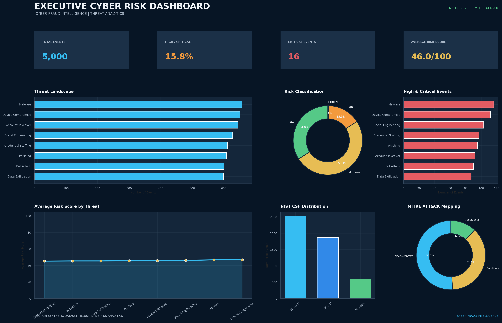

# Cyber Fraud Intelligence & Threat Analytics

  **Cyber Threat Intelligence | Fraud Risk Analytics | MITRE ATT&CK | NIST CSF 2.0**

  Python • Data Analytics • Cyber Risk Scoring • Executive Dashboard

---

##  Executive Summary

This project presents a data-driven approach to Cyber Fraud Intelligence and Threat Analytics, designed to support cybersecurity risk assessment, fraud prevention, threat monitoring, and executive decision-making.

Using 5,000 synthetic cyber threat events, the solution combines heuristic risk scoring, threat classification, MITRE ATT&CK candidate mapping, NIST Cybersecurity Framework (CSF) 2.0 alignment, and strategic action planning.

The project demonstrates how data analytics and cybersecurity frameworks can be integrated into an executive-oriented risk intelligence workflow.

## Resumo Executivo

Este projeto apresenta uma abordagem orientada a dados para Cyber Fraud Intelligence e Threat Analytics, com foco em avaliação de riscos cibernéticos, prevenção a fraudes, monitoramento de ameaças e suporte à tomada de decisão executiva.

Utilizando 5.000 eventos sintéticos de ameaças cibernéticas, a solução combina pontuação heurística de risco, classificação de ameaças, mapeamento candidato ao MITRE ATT&CK, alinhamento ilustrativo ao NIST CSF 2.0 e planejamento estratégico de ações.

O objetivo é demonstrar como analytics, inteligência de ameaças e frameworks de segurança podem ser integrados em um fluxo de gestão de riscos cibernéticos.

---

## 🎯 Project Objectives | Objetivos

- Identify and classify cyber threat events.
- Prioritize events using a weighted risk scoring methodology.
- Explore candidate relationships with MITRE ATT&CK techniques.
- Organize recommended security controls using NIST CSF 2.0.
- Build an executive cyber risk dashboard.
- Generate a strategic action plan based on observed risk indicators.
- Apply data quality and methodology validation checks.

---

## 🏗️ Solution Architecture | Arquitetura da Solução

The analytical workflow includes:

1. Synthetic threat data generation.
2. Exploratory threat landscape analysis.
3. Cyber risk scoring.
4. Risk classification.
5. MITRE ATT&CK candidate mapping.
6. NIST CSF 2.0 illustrative alignment.
7. Executive dashboard development.
8. Strategic risk assessment and action planning.
9. Methodology and data quality validation.

---

## 📊 Cyber Risk Scoring

A weighted heuristic score was implemented to prioritize cyber events.

| Risk component | Weight |
|---|---:|
| Risk indicator | 35% |
| Severity | 30% |
| Failed attempts | 15% |
| Source risk | 10% |
| Affected accounts | 10% |
| **Total** | **100%** |

### Risk Classification

| Classification | Score |
|---|---:|
| Critical | 80–100 |
| High | 60–79.99 |
| Medium | 40–59.99 |
| Low | Below 40 |

The scoring model is illustrative and designed for analytical demonstration, not as a production-validated risk model.

---

## 🛡️ MITRE ATT&CK Integration

The project explores candidate mappings between threat categories and MITRE ATT&CK techniques.

| Threat category | Candidate technique |
|---|---|
| Account Takeover | T1078 – Valid Accounts |
| Credential Stuffing | T1110.004 – Credential Stuffing |
| Phishing | T1566 – Phishing |
| Data Exfiltration | T1041 – Exfiltration Over C2 Channel |

Mapping confidence is represented through three statuses:

- **Candidate:** potential technique association.
- **Conditional:** association requiring additional evidence.
- **Needs context:** insufficient telemetry to assign a technique.

These are analytical hypotheses and do not establish that a technique was confirmed in an actual attack.

---

## 🔐 NIST Cybersecurity Framework 2.0

The solution organizes recommended security actions using the six NIST CSF 2.0 functions:

- GOVERN
- IDENTIFY
- PROTECT
- DETECT
- RESPOND
- RECOVER

The threat-to-control relationships are illustrative recommendations, not a formal compliance assessment or certification.

---

## 📈 Executive Cyber Risk Dashboard

The executive dashboard consolidates risk indicators and threat intelligence into a visual management layer.

Key indicators include:

- Total threat events.
- High and Critical risk exposure.
- Critical event volume.
- Average risk score.
- Threat distribution.
- Risk classification.
- MITRE mapping coverage.
- NIST CSF function distribution.

---

## 📋 Strategic Action Plan

The project generates a strategic action plan with:

- Threat category.
- Observed event volume.
- Average risk score.
- High/Critical event volume.
- Recommended mitigation actions.
- Suggested priority.
- Responsible security area.
- Illustrative implementation timeframe.
- Monitoring KPIs.

The proposed priorities and timeframes are analytical recommendations, not approved operational commitments.

---

## ✅ Data Quality & Methodology Validation

The validation process includes checks for:

- Required columns.
- Missing values.
- Duplicate event identifiers.
- Risk score boundaries.
- Weighted score calculation.
- Risk classification thresholds.
- MITRE mapping status and technique identifiers.
- NIST CSF function taxonomy.

**Validation result:** 9 of 9 checks passed in the final methodology report.

This result confirms the implemented checks passed; it does not constitute independent model validation or framework certification.

---

## 📁 Project Artifacts

| File | Description |
|---|---|
| `Cyber_Fraud_Intelligence_&_Threat_Analytics.ipynb` | Python analytical notebook |
| `cyber_fraud_events_synthetic.csv` | Synthetic threat event dataset |
| `executive_summary.csv` | Executive indicators |
| `executive_cyber_risk_dashboard.png` | Executive dashboard |
| `strategic_action_plan.csv` | Strategic action plan |
| `methodology_validation.csv` | Methodology validation |
| `mitre_validation.csv` | MITRE mapping validation |

---

## 🧰 Technologies & Frameworks

- Python
- Pandas
- NumPy
- Matplotlib
- Seaborn
- Google Colab
- MITRE ATT&CK
- NIST Cybersecurity Framework 2.0
- Data Analytics
- Risk Scoring
- Executive Reporting

---

## ⚠️ Limitations & Disclaimer

All data used in this project is synthetic and generated for educational and analytical demonstration.

The risk scoring weights and thresholds are illustrative. MITRE ATT&CK mappings are candidate hypotheses requiring contextual evidence. NIST CSF relationships are indicative recommendations and do not represent a formal compliance assessment.

This project does not use real customer information, bank data, production telemetry, or confirmed threat intelligence feeds.

---

## 👤 Author

**Elvys Pascoal**

Cyber Fraud Prevention | Fraud Risk Management | Cyber Risk | Data Analytics | AI & Automation

GitHub: [ElvysSergioPascoal425](https://github.com/ElvysSergioPascoal425)

Portfolio: [GitHub Projects](https://github.com/ElvysSergioPascoal425?tab=repositories)

---

*Cyber Fraud Intelligence & Threat Analytics — From Threat Intelligence to Executive Risk Decisions.*
